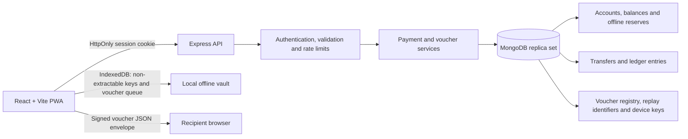

# MeshPay — Offline UPI-Inspired Payment Simulator

**A security-focused offline payment voucher and settlement simulator.**

MeshPay explores a constrained offline-payment workflow: users reserve an allowance while connected, create signed and recipient-encrypted vouchers, hand the voucher packet to another browser, and synchronize it with a server for final verification and settlement.

> **Important:** MeshPay is a portfolio and learning project. It is not connected to NPCI or real UPI rails, does not move real money, and is not a production-ready payment system. All balances and transfers are sandbox data.

## Table of contents

- [Project goals](#project-goals)
- [Features](#features)
- [Architecture](#architecture)
- [Online transfer flow](#online-transfer-flow)
- [Offline voucher flow](#offline-voucher-flow)
- [What no-double-spend means](#what-no-double-spend-means)
- [Technology stack](#technology-stack)
- [Quick start with Docker](#quick-start-with-docker-recommended)
- [Native development](#native-development)
- [Tests and quality checks](#tests-and-quality-checks)
- [Deployment: Render and MongoDB Atlas](#deployment-render-and-mongodb-atlas)
- [API overview](#api-overview)
- [Security model and limitations](#security-model-and-limitations)
- [Troubleshooting](#troubleshooting)
- [Project structure](#project-structure)
- [Future improvements](#future-improvements)
- [License](#license)

## Project goals

MeshPay is built to explore practical backend and security engineering concepts together:

- Treat money amounts as integer paise rather than floating-point rupees.
- Keep online-available funds separate from offline-reserved funds.
- Use atomic database operations and transactions for financial state changes.
- Make retried operations idempotent and reject reuse of an idempotency key with a different request payload.
- Bind offline vouchers to a specific registered recipient device.
- Keep voucher import provisional until the shared backend verifies and settles it.
- Make replay protection, expiry, offline epochs, and concurrent settlement part of the design.

## Features

### Frontend and account features

- React + Vite dashboard with wallet summary, transfers, transaction feed, security center, and offline voucher vault.
- Account registration, login, logout, and authenticated API operations.
- Transaction history and ledger views.
- Service worker support for caching the application shell.

### Backend and data integrity

- Express 5 API with MongoDB and Mongoose.
- Zod request validation, bcrypt password hashing, JWT in an HttpOnly cookie, Helmet headers, origin checks, and rate limiting.
- Integer-paise accounting for persisted money amounts.
- Online transfers recorded with corresponding ledger entries in a MongoDB multi-document transaction.
- Payload-hash-based idempotency: retrying the same logical request with the same key returns its existing result; reusing the key with a different payload returns `409 Conflict`.
- Conditional atomic debit requiring sufficient available balance, reducing concurrent overspend risk.
- MongoDB replica-set configuration for transaction support.

### Offline voucher workflow

- Browser-generated Ed25519 signing keys and RSA-OAEP encryption keys.
- Non-extractable private `CryptoKey` objects persisted in browser IndexedDB.
- Voucher payloads signed with Ed25519 and encrypted using a fresh AES-256-GCM key, wrapped for the recipient device using RSA-OAEP/SHA-256.
- Local signature and recipient checks during import, followed by server-side verification at settlement.
- Receiver binding, expiry and offline-epoch validation, unique voucher IDs, and unique `(deviceId, sequence)` enforcement.
- Settlement-level rejections recorded so a rejected, otherwise valid voucher cannot simply be resubmitted as a new attempt.
- Unused reserve release that increments the sender's offline epoch, invalidating unsubmitted vouchers from the previous epoch.
- QR scanning or JSON copy/paste for packet handoff. This is a direct local handoff—not Bluetooth or a production mesh protocol.

## Architecture



### Main components

| Component | Responsibility |
|---|---|
| React + Vite frontend | Dashboard, authentication UI, transfers, security center, offline vault and handoff workflow |
| Browser IndexedDB | Local device keys and voucher queue/history for the browser profile |
| Express API | Authentication, validation, account operations, voucher sync and settlement decisions |
| MongoDB replica set | Persistent account, transfer, ledger, device, idempotency and voucher state |
| Cryptographic layer | Voucher signatures, recipient-targeted encryption and integrity checks |
| Docker Compose | Local app and transaction-capable MongoDB environment |

## Online transfer flow

1. Validate the recipient, amount, note, authenticated session, and `Idempotency-Key`.
2. Hash the logical request and check whether the sender has already used that key.
3. Start a MongoDB transaction.
4. Conditionally debit the sender only if their available balance is sufficient, credit the recipient, and insert the transfer plus both corresponding ledger entries.
5. Commit the transaction atomically. If a required operation fails, abort rather than leaving a partial debit or credit.

Money is persisted as **integer paise**, never floating-point rupees. For example, ₹125.50 is represented as `12550` paise.

### Idempotency behavior

- Same sender + same idempotency key + same logical payload: return the prior result instead of applying the transfer again.
- Same sender + same idempotency key + different payload: reject with `409 Conflict`.
- A retry of one logical operation must reuse the same key. A new logical operation should use a new random key.

## Offline voucher flow

1. **Initialize while online.** Each user initializes a browser device and registers its public keys. Ed25519 public keys authenticate the sender; RSA-OAEP public keys allow a sender to encrypt a voucher for one registered recipient device.
2. **Reserve funds.** The sender moves an allowance from spendable online funds into a separately tracked offline reserve.
3. **Cache the recipient key.** Before going offline, the sender fetches and caches the recipient's registered device encryption key using `GET /api/offline/contacts?handle=...`. Both devices must have initialized their keys online first.
4. **Build and sign the voucher.** The signed payload binds the voucher ID, sender, recipient handle, amount, device sequence, issuance and expiry times, and offline epoch.
5. **Encrypt for the recipient.** A fresh AES-256-GCM key encrypts the signed voucher. RSA-OAEP/SHA-256 wraps that AES key for the recipient device. The recipient device ID is authenticated as additional data.
6. **Hand off the packet.** Transfer the encrypted JSON envelope by QR scan or JSON copy/paste. This is manual handoff, not Bluetooth, NFC, or a production mesh transport.
7. **Import provisionally.** The recipient's addressed browser decrypts and validates the packet, then stores it locally. Import success is not final settlement.
8. **Sync online.** The server verifies the registered sender device, signature, receiver binding, expiry, offline epoch, and replay identifiers. The settlement transaction updates the reserve and recipient balance and records the relevant transfer, ledger entries, and voucher registry result.
9. **Handle retries safely.** Repeating a successfully settled voucher must return the existing result without crediting the recipient twice.

## What no-double-spend means

The guarantee is intentionally scoped to the shared server ledger; isolated devices cannot coordinate authoritatively while disconnected.

- **One voucher cannot settle twice.** The voucher ID and sender/device sequence have uniqueness constraints, and settlement plus balance changes are transactional.
- **Online funds and offline reserve are separate.** Reserved funds are not available to online transfers.
- **The reserve is the cap on settled voucher value.** A disconnected sender may create multiple provisional vouchers, but their combined settled value cannot exceed the server-side reserve. If the reserve is exhausted, additional vouchers are rejected during synchronization.
- **Reserve release changes the offline epoch.** Releasing unused reserve increments the epoch. Unsubmitted vouchers from the old epoch are rejected, even if the sender later reserves funds again.
- **An offline receipt is not final.** While disconnected, a recipient cannot authoritatively know whether the sender gave another recipient a conflicting provisional voucher or whether the shared reserve will cover settlement. The recipient must sync with the server for finality.

This is a deliberate design boundary. A production-grade regulated offline-payment system would require additional risk limits, device and recovery assumptions, stronger operational controls, compliance work, and independent certification. MeshPay must not be represented as an actual UPI client.

## Technology stack

| Area | Technology |
|---|---|
| Frontend | React, Vite, service worker / application-shell caching |
| Backend | Node.js, Express 5 |
| Database | MongoDB, Mongoose, replica set |
| Validation | Zod |
| Authentication | bcrypt password hashing, JWT in HttpOnly cookie |
| Browser-local storage | IndexedDB, Web Crypto API |
| Cryptography | Ed25519, RSA-OAEP/SHA-256, AES-256-GCM |
| Hardening | Helmet, origin checks, rate limits |
| Testing | Vitest, cryptographic smoke tests, integration tests |
| Local environment | Docker, Docker Compose |
| Deployment target | Render web service with MongoDB Atlas |

Confirm exact dependency versions in `package.json` and the lockfile for the version you publish.

## Quick start with Docker (recommended)

### Requirements

- Docker Desktop with Docker Compose.
- Git, if cloning from GitHub.

The Compose configuration sets up MongoDB as a replica set, which is required for the multi-document transactions used by the application.

### 1. Get the code

After creating the GitHub repository, clone it and enter the project directory:

```powershell
git clone YOUR_GITHUB_REPOSITORY_URL
cd YOUR_REPOSITORY_FOLDER
```

If you already have the project on your machine, open PowerShell in the project root instead.

### 2. Create the environment file

```powershell
Copy-Item .env.example .env
node -e "console.log(require('node:crypto').randomBytes(48).toString('base64url'))"
```

Copy the generated random value into `.env` as `JWT_SECRET=...`. Keep `.env` private. Do not commit it or share its contents in screenshots or logs.

Review `.env.example`, `docker-compose.yml`, and the server configuration to confirm all required variable names and values. Never assume the sample values are production-ready.

### 3. Start the stack

```powershell
docker compose up --build
```

Keep that terminal open while using the app. Alternatively, run in the background with `docker compose up -d --build`.

### 4. Open the app and check health

Open [http://localhost:5000](http://localhost:5000).

Check liveness and readiness:

- [http://localhost:5000/api/health/live](http://localhost:5000/api/health/live)
- [http://localhost:5000/api/health/ready](http://localhost:5000/api/health/ready)

Readiness should confirm that the app can reach a transaction-capable database topology.

### 5. Try the demo

Create two sandbox accounts in separate browser profiles (or separate browsers). Test an online transfer first. Then initialize both devices while online, reserve a small allowance on the sender, cache the recipient's device key, create a voucher, import it on the recipient, and sync it for settlement.

### 6. Stop the stack

If running in the foreground, press `Ctrl+C`. Then run:

```powershell
docker compose down
```

Persistent local MongoDB data lives in the configured volume (reported as `mongo_data` in the current setup). To delete local accounts and transactions too, run `docker compose down -v`. **This deletes local demo data; use it only when intentional.**

## Native development

### Requirements

- Node.js 20.19+ (Node.js 22 LTS is recommended).
- npm.
- MongoDB configured as a replica set, or a MongoDB Atlas connection string.

MongoDB multi-document transactions require a replica-set or sharded-cluster deployment; a standalone MongoDB server is not sufficient.

### Install and configure

```powershell
npm install
Copy-Item .env.example .env
```

Set a unique random `JWT_SECRET` and confirm `MONGODB_URI` points to a replica-set URI. Keep the generated `package-lock.json` in version control so installs are reproducible.

### Run the app

```powershell
npm run dev
```

The project is configured to start the Express API at `http://localhost:5000` and Vite at `http://localhost:5173`, with Vite proxying `/api` to Express. Use the exact local URLs printed by the terminal. If Docker already occupies port 5000, stop the conflicting API container before starting another API process.

The API should fail to start with a clear message if the configured MongoDB topology cannot support transactions. The readiness endpoint should also report whether the database is ready.

## Tests and quality checks

Run from the repository root:

```powershell
npm run test:crypto
npm test
npm run build
npm run check
```

You can also run lint separately:

```powershell
npm run lint
```

### What the tests cover

The standalone crypto smoke test is designed to check Ed25519 signatures, rejection of signature tampering, RSA-OAEP/AES-256-GCM encryption/decryption, ciphertext integrity, and recipient-device binding.

The integration test suite is designed to cover authentication and origin checks, malformed JSON, sequential and concurrent idempotency retries, same-key payload changes, online and cross-channel overspend attempts, ledger reconciliation, registered Ed25519/RSA device keys, offline signature validation, wrong-recipient protection, concurrent duplicate settlement, insufficient reserve, reused device sequences, and revoked offline epochs.

`mongodb-memory-server` may download a MongoDB binary the first time integration tests run; network access may be required for that initial setup.

Run the checks on the exact commit you plan to publish. A successful test run is useful evidence, but is not a guarantee that every bug or security weakness has been found.

## Deployment: Render and MongoDB Atlas

The recommended deployment shape is one Node web service that serves both the frontend and API from one origin, simplifying cookie and origin configuration.

> Deploy this as a demonstration only. Do not use real payment data, real funds, or production credentials in the demo.

### 1. Push the project to GitHub

Create an empty GitHub repository, then push your local code. Ensure `.env`, credentials, private keys, and local database files are not committed.

### 2. Create a MongoDB Atlas database

- Create a database and a dedicated database user with a strong password.
- Configure a replica-set connection URI suitable for the deployment.
- Use the narrowest network access rules supported by your hosting plan.
- Do not expose MongoDB directly to the public internet with broad access rules.

### 3. Configure Render

If the repository contains a valid `render.yaml`, create a Render Blueprint from the repository. Otherwise, create a Node web service and use the commands configured for this project. The current suggested commands are:

**Build command**

```bash
npm install --include=dev --no-audit --no-fund && npm run build && npm prune --omit=dev
```

**Start command**

```bash
npm start
```

**Health check path**

```text
/api/health/ready
```

Confirm these commands against the repository's `package.json`, `Dockerfile`, and `render.yaml` before deploying.

### 4. Configure environment variables

Set the following in the hosting dashboard using the exact names expected by the application:

- `MONGODB_URI`: MongoDB Atlas replica-set URI.
- `JWT_SECRET`: a long, randomly generated secret unique to the deployment.
- `APP_ORIGIN`: the exact public origin, for example `https://your-service.onrender.com`, without a trailing slash if the application expects that format.
- `NODE_ENV=production`.

Do not put secret values in this README or in GitHub. Set them through the hosting provider's secret environment-variable interface.

### 5. Verify after deployment

1. Wait for the service to become healthy.
2. Open `/api/health/ready` on the deployed origin.
3. Create two sandbox users.
4. Test a small online transfer and check account balances and the ledger.
5. Initialize recipient and sender device keys while online.
6. Test reserve, voucher creation, recipient import, synchronization, final settlement, and duplicate retry.
7. Review application logs for errors without exposing secrets or personal data.

Free hosting plans may sleep or impose resource limits. A sleeping or best-effort demo service is not suitable for real payments.

## API overview

The following routes describe the intended application surface. Verify route names and authorization requirements against the version of the code you publish.

| Method | Endpoint | Purpose |
|---|---|---|
| `POST` | `/api/auth/register` | Register a sandbox user and establish a session |
| `POST` | `/api/auth/login` | Authenticate a user |
| `POST` | `/api/auth/logout` | Clear the session cookie |
| `GET` | `/api/auth/me` | Return the current authenticated user |
| `GET` | `/api/wallet` | Read balances and offline allowance information |
| `POST` | `/api/transfers` | Create an online transfer; uses `Idempotency-Key` |
| `POST` | `/api/offline/reserve` | Move available funds into offline reserve; uses `Idempotency-Key` |
| `POST` | `/api/offline/release` | Return unused reserve and advance the offline epoch; uses `Idempotency-Key` |
| `POST` | `/api/offline/devices` | Register device signing and encryption public keys |
| `GET` | `/api/offline/contacts?handle=...` | Fetch registered recipient device encryption keys while online |
| `GET` | `/api/offline/status` | Read reserve, device and voucher status information |
| `POST` | `/api/offline/sync` | Validate and settle an incoming voucher |
| `GET` | `/api/offline/vouchers` | Read server-side voucher history for the receiver |
| `GET` | `/api/transactions` | Read recent transfers and reserve movements |
| `GET` | `/api/ledger` | Read the current account's ledger entries |
| `GET` | `/api/ledger/reconcile` | Compare ledger totals with account balances |
| `GET` | `/api/health/live` | Process liveness check |
| `GET` | `/api/health/ready` | Database and application readiness check |

Amounts in API payloads are integer paise, not floating-point rupees. For a retry of the same logical operation, reuse the same `Idempotency-Key`; use a new random key for a new operation.

## Security model and limitations

### Controls implemented in the project

- **Authentication:** bcrypt password hashes, signed JWT in an HttpOnly cookie, `SameSite=Lax`, and `Secure` in production as configured by the application.
- **Authorization:** protected account operations and receiver binding during voucher sync.
- **Validation:** Zod request schemas, amount bounds, restricted JSON body size, and safer error responses.
- **Abuse resistance:** rate limits, Helmet headers, allowed-origin checks, and cross-site request metadata checks for state-changing requests.
- **Financial integrity:** integer-paise representation, conditional debits, MongoDB transactions, uniqueness constraints, and ledger entries.
- **Online idempotency:** sender-scoped idempotency keys and a request digest.
- **Offline replay controls:** voucher identifiers, device sequence numbers, epochs, and server-side settlement records.
- **Voucher confidentiality and integrity:** a fresh AES-256-GCM key encrypts the signed voucher; RSA-OAEP/SHA-256 wraps the AES key to the recipient device's public key; Ed25519 signatures authenticate voucher contents; recipient-device binding is checked.
- **Browser key storage:** private `CryptoKey` objects are intended to be non-extractable and persisted in IndexedDB. Non-extractability limits direct key export; it does not protect against every attack that can execute inside a compromised browser profile.

### Explicit limitations

- The application does not connect to NPCI/UPI rails, a bank, phone-number verification, a hardware security module, secure-element counters, or certified device attestation.
- Local browser state may be lost if a user clears site data, changes browser profiles, or loses a device. Recovery and key rotation require deliberate design.
- A browser that is compromised may misuse cryptographic operations available to it even if key material is marked non-extractable.
- The server is required for final settlement. A disconnected recipient cannot know that a voucher is final or that another provisional voucher will not compete for the same reserve.
- JWT logout that only clears a client cookie does not necessarily revoke a copied, unexpired token server-side. Production deployments should evaluate revocation and session-management requirements.
- Public deployment requires a threat model, penetration testing, key lifecycle review, secure logging, monitoring, backup and recovery plans, privacy/compliance work, rate-limit tuning, and independent security assessment.

**Do not use this prototype to transfer real money or sensitive payment credentials.** Test only with synthetic accounts and values.

## Troubleshooting

### Readiness check fails

Check `docker compose ps` and inspect logs:

```powershell
docker compose ps
docker compose logs --since=10m app
docker compose logs --since=10m mongo
```

Use the exact MongoDB service name shown in your Compose file if it differs from `mongo`. Verify that MongoDB initialized as a replica set and that the API's connection string points to it.

### MongoDB transaction errors

Multi-document transactions require a replica set or sharded cluster. A standalone MongoDB server is not enough. For local development, the supplied Docker Compose setup is the simplest option.

### Offline voucher cannot be decrypted

Initialize the recipient account's device in the same browser profile while online. Then refresh/cache the recipient's current registered encryption key on the sender device and create a new voucher for that key. A voucher encrypted for an older or different recipient device key will not decrypt on the new device.

### Imported voucher is not settled

Import is provisional. Reconnect the recipient browser to the shared backend and use the sync action. If the server rejects the voucher, inspect the API response and server logs to determine whether the issue is the signature, recipient binding, expiry, offline epoch, replay state, or insufficient reserve. Do not repeatedly create vouchers to bypass a settlement rejection.

### Port 5000 is already in use

Stop the other process/container using the port or run only the frontend development server with the API already running, following the project's Vite proxy settings. Avoid starting two API processes on the same port.

## Project structure

The precise tree may change; use the repository as the source of truth. The key areas include:

| Path | Responsibility |
|---|---|
| `client/` | React/Vite frontend and offline vault UI |
| `server/` | Express routes, middleware, services and persistence logic |
| `tests/` | Integration and security tests |
| `scripts/` | Cryptographic smoke tests and project scripts |
| `package.json` | Scripts and dependency declarations |
| `package-lock.json` | Resolved dependency tree for repeatable installs |
| `docker-compose.yml` | Local application and MongoDB setup |
| `Dockerfile` | Application image build, if present |
| `render.yaml` | Render Blueprint configuration, if present |
| `.env.example` | Environment-variable template |

## Future improvements

- End-to-end browser tests covering two independently initialized device profiles.
- Better structured audit events for voucher rejection and settlement outcomes.
- Load and race-condition testing under injected network/database failures.
- Documented threat model and external security review.
- More complete peer-to-peer transport options, with explicit pairing and recovery design.
- Deployment monitoring, key lifecycle management, session revocation, and tested backup/recovery procedures.

These are possible future improvements, not claims that they are already implemented.

## License

No license is implied by this README. Before publishing, add a `LICENSE` file for the license you actually choose. If no license file exists, do not claim that others have permission to reuse or redistribute the code.
